# Data model

All tables live in `shared/schema.ts` (Drizzle) with matching DDL in `server/db.ts`. Every
tenant-scoped table carries `organization_id`; every storage method takes it as the first
argument (existing DocTurn invariant). **No table stores note text, context packages, or EHR
tokens.**

```mermaid
erDiagram
  organizations ||--o{ users : has
  organizations ||--o{ ehr_connections : "onboarded EHRs"
  ehr_connections ||--o{ ehr_user_links : "fhirUser → user"
  users ||--o{ ehr_user_links : ""
  organizations ||--o{ note_template_versions : "org override (null = platform default)"
  organizations ||--o{ org_connectors : "enabled sources"
  organizations ||--|| licenses : "one license"
  organizations ||--o{ license_usage : "per period per user"
  organizations ||--o{ audit_logs : "actions only"

  ehr_connections {
    int id PK
    int organization_id FK
    text name
    text vendor "epic|cerner|athena|meditech|other|mock"
    text iss "FHIR R4 base URL; = SMART iss (unique per org)"
    text client_id
    text client_secret_enc "AES-256-GCM; null = public client (PKCE)"
    text scopes
    bool write_back
    bool jit_provisioning
    text jit_role
    bool enabled
  }
  ehr_user_links {
    int id PK
    int ehr_connection_id FK
    text fhir_user "Practitioner/123"
    int user_id FK
  }
  note_template_versions {
    int id PK
    int organization_id FK "null = platform default"
    text name
    int version "monotonic per (scope,name)"
    text status "draft|active|retired (one active per scope)"
    jsonb module "the template module (see 04)"
    text checksum "sha256 prefix of module"
    text changelog
    int created_by FK
    int activated_by FK
    timestamp activated_at
  }
  org_connectors {
    int id PK
    int organization_id FK
    text connector_key "uptodate|baa-llm|doximity|openevidence|metriport|engine|..."
    text kind "knowledge|aggregator|engine"
    bool enabled
    int priority "lower runs first"
    jsonb config "secrets encrypted at rest"
  }
  licenses {
    int id PK
    int organization_id FK "unique"
    text plan "trial|seat|usage"
    text status "active|suspended|expired"
    int seats "seat plans: distinct users / period"
    int usage_cap "usage plans: generations / period"
    timestamp period_end
    text billing_ref "e.g. Stripe subscription item"
  }
  license_usage {
    int organization_id FK
    text period_key "YYYY-MM"
    int user_id FK
    int generations
    int exports
  }
  audit_logs {
    int organization_id FK
    int user_id FK
    text action "notes.launch | notes.context_assembled | notes.generated | notes.exported | notes.template_activated | notes.connector_enabled | ..."
    jsonb details "counts + references only (patient id, encounter id, template version, engine). Never content."
    text risk_level
  }
```

## Audit events emitted by the plugin

| action | details (all non-content) | risk |
|---|---|---|
| `notes.launch` | vendor, launchType (ehr/standalone), patient, encounter | low |
| `notes.user_jit_provisioned` | ehrConnectionId, fhirUser | medium |
| `notes.context_assembled` | patient, encounter, counts per resource, sources, connectors run | low |
| `notes.generated` | patient, encounter, engine, templateVersion, warnings count, chars | low |
| `notes.asked` | connector | low |
| `notes.exported` | mode (clipboard/documentreference), patient, encounter, documentReferenceId, chars | low |
| `notes.session_discarded` | — | low |
| `notes.template_created` / `notes.template_activated` | name, version, checksum | medium |
| `notes.connector_enabled` / `notes.connector_disabled` | connector, kind, config keys (not values) | medium |
| `notes.ehr_created` / `notes.ehr_updated` | vendor, iss | medium |
| `notes.license_set` | plan, status, seats, usageCap | medium |

PHI *access* (not content) is additionally recorded in the existing `phi_access_logs` for
`notes.context`, `notes.generate`, `notes.export` (user, route, IP, user agent).

## Ephemeral (session-only) structures

`server/notes/types.ts`:

* `SmartPending` — state, PKCE verifier, redirect URI, endpoints (lives ≤10 min during the
  OAuth dance).
* `SmartSession` — access/refresh token, expiry, scope, `patientId`, `encounterId`, `fhirUser`.
  Stored in `req.session` (memory store in dev; `connect-pg-simple` or Redis with TTL in
  production — see 08).
* `ContextPackage` — the structured, minimum-necessary context (see 03). Returned to the
  browser; never written server-side.
