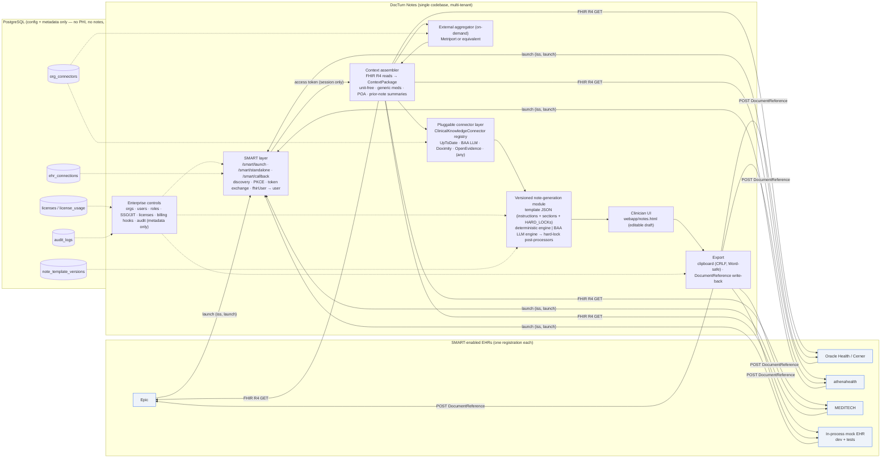

# DocTurn Notes — multi-EHR clinical-note plugin (architecture)

A sellable, multi-tenant SMART on FHIR app that assembles patient context from any
SMART-enabled EHR, enriches it through pluggable clinical-knowledge connectors, runs a
clinician-controlled **versioned note-generation module** (the locked H&P template), and
exports the reviewed note by clipboard or FHIR `DocumentReference` write-back. Note
content and intermediate PHI are **ephemeral** — only action metadata is logged.

| Deliverable | Where |
|---|---|
| Architecture overview + diagram | this file |
| Data model (orgs, users, licenses, audit, template versions, connectors) | [01_DATA_MODEL.md](01_DATA_MODEL.md) |
| SMART on FHIR launch and token flow | [02_SMART_LAUNCH.md](02_SMART_LAUNCH.md) |
| FHIR resource mapping + DocumentReference write-back | [03_FHIR_MAPPING_WRITEBACK.md](03_FHIR_MAPPING_WRITEBACK.md) |
| Note-generation module interface | [04_NOTE_MODULE_INTERFACE.md](04_NOTE_MODULE_INTERFACE.md) |
| Standard connector interface + stubs | [05_CONNECTOR_INTERFACE.md](05_CONNECTOR_INTERFACE.md) |
| Activating a template version / enabling a connector / onboarding an EHR | [06_ADMIN_EXAMPLES.md](06_ADMIN_EXAMPLES.md) |
| Minimal prototype path (runs today, zero secrets) | [07_PROTOTYPE_PATH.md](07_PROTOTYPE_PATH.md) |
| Security & compliance checklist; EHR registration vs. customer activation | [08_SECURITY_COMPLIANCE.md](08_SECURITY_COMPLIANCE.md) |

Everything described here is **implemented** in this repository (`server/notes/`,
`server/routes/notes.ts`, `webapp/notes.html`, `tests/notes.test.ts`) unless a section is
explicitly marked *production hardening*.

## 1. Product principles → how the code enforces them

| Principle | Enforcement |
|---|---|
| Thin orchestration layer, never the system of record | The only durable rows are configuration + metadata (`ehr_connections`, `note_template_versions`, `org_connectors`, `licenses`, `license_usage`, `audit_logs`). There is no table for notes, context, or tokens. |
| Notes and intermediate PHI are ephemeral | Context package is returned to the browser and sent back for generation; tokens live in the server session; `DELETE /api/notes/session` (or session expiry) discards everything. Audit `details` carry counts and references, never text (tested). |
| One codebase, multi-EHR via SMART | `server/notes/smart/*` implements HL7 SMART App Launch v2 (discovery, PKCE, EHR + standalone launch). Vendors differ only by a row in `ehr_connections`. |
| Note rules live in a versioned, customizable module | `note_template_versions` holds JSON modules; one `active` per scope (org override → platform default). Activation is an API call, not a deploy. HARD_LOCK rules are machine-enforced post-processors. |
| Clinical sources are pluggable | `ClinicalKnowledgeConnector` interface + registry. Adding a source = one file + one registry line. Per-org enablement, encrypted secrets, minimum-necessary projection. |
| We control orgs, licensing, billing, auditing | `licenses` enforced before generate/export; billing hooks; developer-only license management; audit on every action. |

## 2. Component diagram



### Request-level view (one clinician session)

```
EHR ──launch──▶ /smart/launch ──302──▶ EHR authorize (PKCE) ──302──▶ /smart/callback
                                                                       │ token exchange, id_token → fhirUser → DocTurn user (link or JIT)
                                                                       ▼
                                                     req.session.smart = { token, patient, encounter }   (ephemeral)
                                                                       │
browser ◀── /notes.html ◀──────────────────────────────────────────────┘
   │  POST /api/notes/context            → FHIR reads → [aggregator] → [connectors] → ContextPackage (returned, not stored)
   │  POST /api/notes/generate           → license check → active template → engine → HARD_LOCKs → NoteResult
   │  (clinician edits)
   │  POST /api/notes/export clipboard   → CRLF text          ┐ license metered, audit {user, action, time, patient ref}
   │  POST /api/notes/export docref      → POST DocumentReference ┘
   └  DELETE /api/notes/session          → tokens + context discarded
```

## 3. Code map

```
server/notes/
  types.ts                    ContextPackage, VisitInput, NoteResult, SmartSession (all ephemeral)
  secrets.ts                  AES-256-GCM at-rest encryption for client secrets / connector keys
  smart/discovery.ts          .well-known/smart-configuration (+ CapabilityStatement fallback)
  smart/launch.ts             PKCE, authorize URL, code exchange, refresh, id_token claims
  fhir/client.ts              FHIR R4 client (read / search with paging / create / Binary)
  fhir/mapping.ts             FHIR → context (unit-free, generic names, POA)
  context/assembler.ts        Pulls the standard resources; summarizes prior notes
  connectors/types.ts         ClinicalKnowledgeConnector interface + minimum-necessary projection
  connectors/registry.ts      Registry, per-org runner, ad-hoc query
  connectors/uptodate.ts      UpToDate Expert AI / Connect (live when keyed, stub otherwise)
  connectors/baa-llm.ts       BAA-covered LLM fallback
  connectors/generic-source.ts Template for Doximity / OpenEvidence / any HTTP JSON source
  connectors/metriport.ts     On-demand external aggregator + merge
  generation/template.ts      Template-module JSON schema (zod) + checksum
  generation/default-template.ts  Platform default v1: the locked H&P rules
  generation/hardlocks.ts     Machine-enforced HARD_LOCK post-processors
  generation/llm.ts           BAA LLM provider abstraction (Anthropic / OpenAI-compatible / stub)
  generation/engine.ts        NoteEngine interface, deterministic + LLM engines, generateNote()
  export/clipboard.ts         Word-safe CRLF
  export/documentreference.ts DocumentReference builder + write-back
  licensing.ts  billing.ts    Seat/usage/trial enforcement; billing hooks (log / Stripe)
  mock-ehr.ts                 In-process SMART/FHIR sandbox for dev + tests
server/routes/notes.ts        All /smart/* and /api/notes/* endpoints
webapp/notes.html             Clinician UI (launch → context → generate → review → export)
tests/notes.test.ts           End-to-end against the mock EHR + unit tests for the hard locks
```

## 4. Form factors

* **Primary (built):** web app launched from the EHR (Mac/Windows/ChromeOS browsers).
  Nothing is installed at the hospital; the EHR opens a URL.
* **Later:** a desktop companion (macOS/Windows) that calls the same `/api/notes/*` endpoints
  and inserts at the cursor; an iOS build of the existing Expo app for review/export. Both reuse
  the SMART session (standalone launch) and the same API — no new server code.
